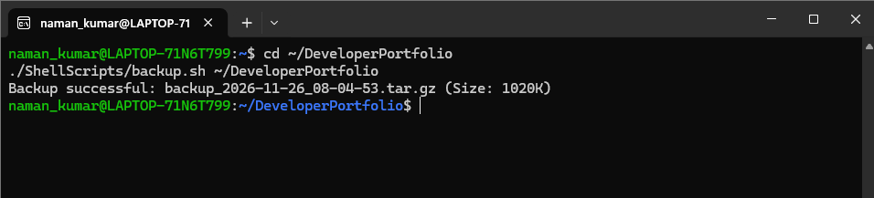
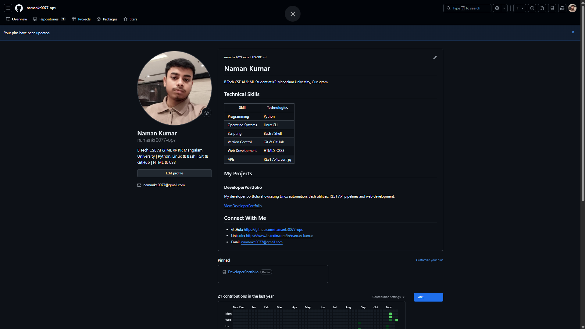
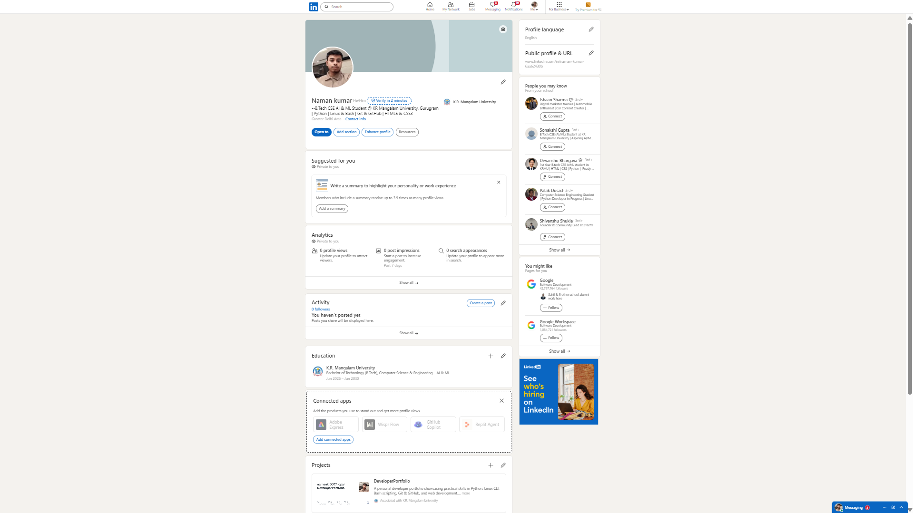

# DeveloperPortfolio

Personal developer portfolio and systems engineering capstone by **Naman Kumar** (B.Tech CSE, Batch 2026-2030).

- **Live Portfolio Website:** https://namankr0077-ops.github.io/DeveloperPortfolio/
- **GitHub Profile:** https://github.com/namankr0077-ops
- **LinkedIn Profile:** https://www.linkedin.com/in/naman-kumar-6aa62430b

## Repository Sections

- **Linux/** (Q1): Hardware specs table, binary conversion walkthrough (`system_profile.md`), and CLI outputs (`commands_output.txt`)
- **ShellScripts/** (Q2): Executable system reporter (`sysinfo.sh`) and timestamped `.tar.gz` backup utility (`backup.sh`)
- **API/** (Q3): Raw JSON payloads from GitHub & JSONPlaceholder APIs plus `jq` analysis (`api_summary.md`)
- **Portfolio/** (Q4): One-page technical resume (`resume.pdf`) and semester-wise roadmap (`learning_roadmap.md`)
- **Screenshots/**: Proof of backup script execution, GitHub profile, and LinkedIn profile

## Verification Screenshots

### Automated Backup Script Execution

### GitHub Profile

### LinkedIn Profile

